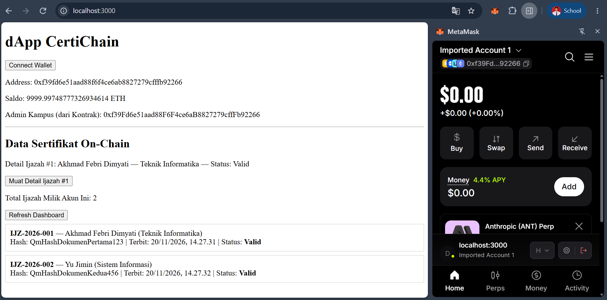

# Laporan Praktikum Pertemuan 10: Membaca Data Smart Contract di Frontend (Dashboard CertiChain).

## 1. Tujuan Praktikum
1. Menghubungkan antarmuka web (*frontend*) dengan smart contract `CertiChain.sol` pada jaringan lokal Hardhat menggunakan Ethers.js v6.
2. Melakukan pembacaan data tunggal (`verifikasiIjazah`) maupun pembacaan banyak data secara paralel (`Promise.all`) dari blockchain tanpa biaya *gas* (*view functions*).
3. Menerapkan penanganan error (*error handling*) untuk validasi jaringan (`chainId: 31337`) serta konversi tipe data `BigInt` (`uint256`) agar aman ditampilkan di antarmuka web.

## 2. Ringkasan Implementasi

### A. Seeding Data Awal (`deploy.js`)
Pada skrip deployment berbasis ES Module, setelah kontrak `CertiChain` berhasil di-deploy ke jaringan lokal, skrip otomatis menerbitkan dua sertifikat awal menggunakan fungsi `terbitkanIjazah()` agar dashboard langsung memiliki data untuk ditampilkan:
* `IJZ-2026-001` — Akhmad Febri Dimyati (Teknik Informatika)
* `IJZ-2026-002` — Yu Jimin (Sistem Informasi)

### B. Antarmuka Dashboard (`index.html`)
Menambahkan elemen tampilan untuk menampilkan hasil pembacaan data *on-chain*, meliputi:
* Informasi alamat *Admin Kampus* yang ditarik langsung dari kontrak.
* Tombol **Muat Detail Ijazah #1** untuk memeriksa detail dan status validasi satu sertifikat spesifik.
* Informasi total sertifikat milik akun terhubung serta tombol **Refresh Dashboard** untuk memperbarui daftar kartu sertifikat.

### C. Logika Pembacaan Data & Penanganan Error (`app.js`)
* **Inisialisasi Kontrak:** Menggunakan `ethers.BrowserProvider(window.ethereum)` dan `ethers.Contract(alamatKontrak, abi, provider)` dalam mode baca (*read-only*).
* **Pembacaan Tunggal (`muatStatus`):** Memanggil fungsi `kontrak.verifikasiIjazah("IJZ-2026-001")` untuk menampilkan nama pemilik, program studi, dan status keabsahan ijazah.
* **Pembacaan Paralel (`muatDashboard`):** Memanggil `kontrak.lihatIjazahMahasiswa(accounts[0])` untuk mendapatkan daftar nomor ijazah milik mahasiswa, lalu mengambil seluruh detailnya secara bersamaan menggunakan `Promise.all(daftarNomor.map(...))`.
* **Konversi Tipe Data & Validasi:** Mengonversi nilai `BigInt` dari blockchain menggunakan `.toString()` dan `Number(...)` untuk format waktu penerbitan, serta memeriksa `net.chainId !== 31337n` di dalam blok `try/catch` untuk mencegah error saat MetaMask berada di jaringan yang salah.

## 3. Hasil Pengujian Dashboard

Berikut adalah tangkapan layar aplikasi dApp CertiChain setelah berhasil terhubung ke MetaMask (jaringan Hardhat Local) dan menampilkan data sertifikat langsung dari smart contract:

**Analisis Hasil:**
* Alamat `Admin Kampus` (`0xf39Fd6e51aad88F6F4ce6aB8827279cffFb92266`) berhasil dibaca otomatis saat halaman dimuat.
* Tombol **Muat Detail Ijazah #1** berhasil menampilkan data sertifikat pertama dengan status **Valid**.
* Dashboard berhasil menghitung total sertifikat milik akun aktif (`2`) dan merender kedua kartu sertifikat (`IJZ-2026-001` dan `IJZ-2026-002`) secara dinamis dari blockchain.

## 4. Kesimpulan
Pembacaan data dari smart contract menggunakan fungsi `view` di Ethers.js tidak memerlukan transaksi *on-chain* maupun biaya *gas*. Penggunaan `Promise.all` terbukti efektif mempercepat proses pemuatan banyak data sertifikat sekaligus ke dalam elemen kartu HTML, sementara pengecekan `chainId` dan penanganan blok `try/catch` menjaga aplikasi tetap informatif ketika terjadi ketidaksesuaian jaringan.