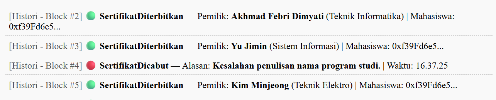
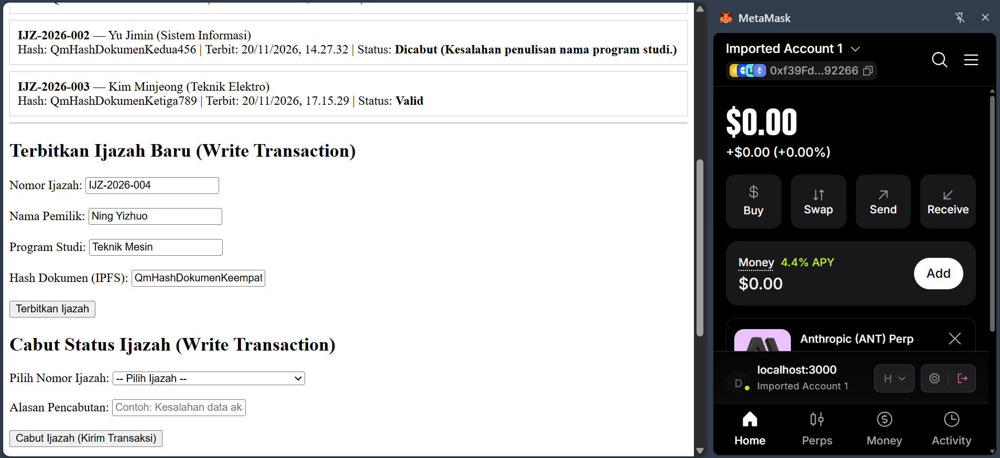
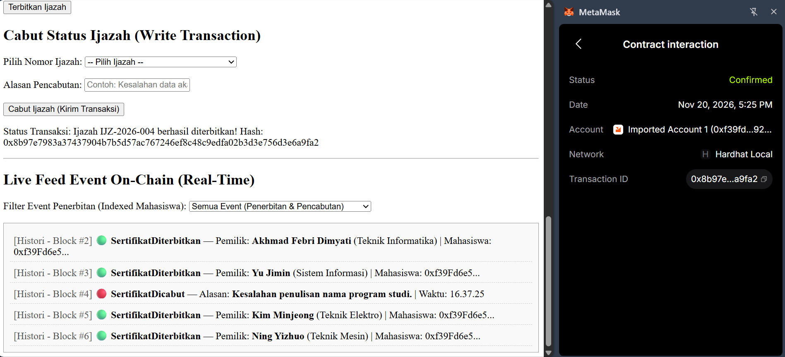
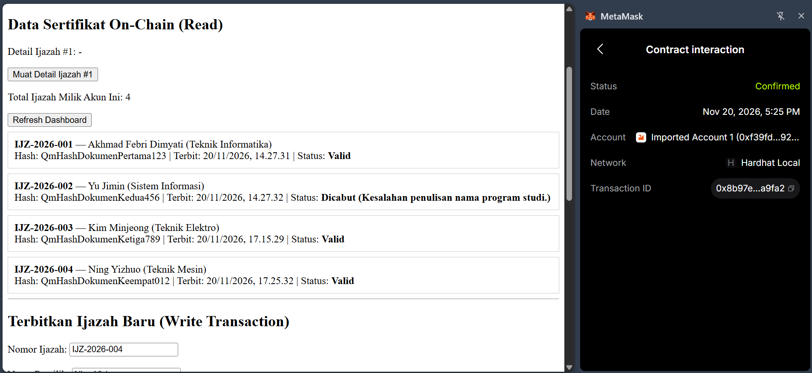

# Laporan Praktikum Pertemuan 12: Event Listening & Real-Time Update (Live Feed CertiChain).

## 1. Tujuan Praktikum
1. Memahami mekanisme deklarasi `event` dengan parameter `indexed` dan pemancaran log (`emit`) pada smart contract `CertiChain.sol` saat terjadi perubahan *state*.
2. Memuat histori event lama dari jaringan blockchain menggunakan `kontrak.queryFilter()` saat halaman pertama kali dibuka.
3. Memasang *event listener* real-time menggunakan `kontrak.on()` sehingga Live Feed otomatis menampilkan aktivitas terbaru di bagian teratas tanpa perlu memuat ulang halaman maupun menekan tombol refresh.
4. Menerapkan penyaringan event berbasis parameter `indexed` menggunakan `kontrak.filters` serta melepas listener (`kontrak.off()`) saat halaman ditutup agar tidak terjadi duplikasi handler.

## 2. Ringkasan Implementasi

### A. Deklarasi Event pada Smart Contract (`Certichain.sol`)
Smart contract `CertiChain.sol` telah memiliki dua event dengan parameter `indexed` yang dipancarkan setiap kali terjadi perubahan *state*:
* `event SertifikatDiterbitkan(string indexed nomorIjazah, string namaPemilik, string programStudi, address indexed mahasiswa)` — dipancarkan oleh fungsi `terbitkanIjazah()`.
* `event SertifikatDicabut(string indexed nomorIjazah, string alasan, uint256 waktu)` — dipancarkan oleh fungsi `cabutIjazah()`.

### B. Antarmuka Live Feed & Filter Event (`index.html`)
Menambahkan bagian **Live Feed Event On-Chain (Real-Time)** pada antarmuka web yang terdiri dari:
* Dropdown filter event (`#filterEvent`) untuk menyaring riwayat event penerbitan berdasarkan alamat mahasiswa yang bertanda `indexed`.
* Kontainer daftar log (`#elFeed`) yang menampilkan histori log transaksi dan pembaruan event baru secara real-time.

### C. Logika Histori, Listener & Filter Indexed (`app.js`)
* **Pemuatan Histori (`muatFeedSemua`):** Menggunakan `kontrak.queryFilter("SertifikatDiterbitkan", 0, "latest")` dan `kontrak.queryFilter("SertifikatDicabut", 0, "latest")`, menggabungkan kedua log berdasarkan urutan `blockNumber` dan `logIndex`, lalu menampilkannya ke DOM dari blok terlama ke terbaru.
* **Real-Time Listener (`pasangListener`):** Memasang `kontrak.on("SertifikatDiterbitkan", ...)` dan `kontrak.on("SertifikatDicabut", ...)` sekali saat halaman dimuat. Setiap event baru yang diterima langsung disisipkan di posisi paling atas menggunakan `insertAdjacentHTML("afterbegin", ...)`.
* **Filter Indexed (`terapkanFilterFeed`):** Memanfaatkan `kontrak.filters.SertifikatDiterbitkan(null, null, null, targetAddress)` untuk mengambil log penerbitan khusus untuk alamat mahasiswa tertentu secara langsung dari log blockchain.
* **Pembersihan Listener:** Menambahkan event `beforeunload` yang memanggil `kontrak.off(...)` untuk mencegah penumpukan listener saat halaman di-reload.

## 3. Hasil Pengujian Live Feed (Sebelum & Sesudah Transaksi)

### A. Kondisi Live Feed Sebelum Transaksi
Saat halaman dibuka, `queryFilter` otomatis mengambil histori 4 event yang sudah tercatat sebelumnya pada Block #2, Block #3, Block #4, dan Block #5:

### B. Kondisi Live Feed Sesudah Transaksi Penerbitan Ijazah Baru
Setelah mengirimkan transaksi penerbitan sertifikat baru (`IJZ-2026-004` atas nama **Ning Yizhuo**, Program Studi **Teknik Mesin**, Hash IPFS `QmHashDokumenKeempat012`) dan dikonfirmasi di MetaMask, event baru langsung muncul otomatis pada **Block #6** di Live Feed:

**Detail Transaksi Pengujian:**
- **Fungsi Dipanggil:** `terbitkanIjazah("IJZ-2026-004", "Ning Yizhuo", "Teknik Mesin", "QmHashDokumenKeempat012", ...)`
- **Transaction Hash:** `0x...` *(ganti dengan hash transaksi IJZ-2026-004 dari web/MetaMask kamu)*
- **Status Transaksi:** Confirmed (`Block #6`)
- **Hasil Pengamatan:** Event `SertifikatDiterbitkan` untuk pemilik **Ning Yizhuo (Teknik Mesin)** langsung muncul otomatis di bagian teratas Live Feed tanpa menekan tombol refresh, total ijazah milik akun bertambah menjadi 4, dan setelah halaman di-reload seluruh histori tampil urut tanpa duplikasi.

## 4. Kesimpulan
Penggunaan `queryFilter` dan `kontrak.on` pada Ethers.js v6 memungkinkan aplikasi web menyinkronkan riwayat sekaligus memantau perubahan *state* smart contract secara otomatis tanpa interaksi refresh manual dari pengguna. Penambahan parameter `indexed` pada definisi `event` di Solidity mempermudah penyaringan log spesifik langsung dari jaringan blockchain, sementara pembersihan listener menggunakan `kontrak.off` menjaga aplikasi bebas dari eksekusi handler ganda.