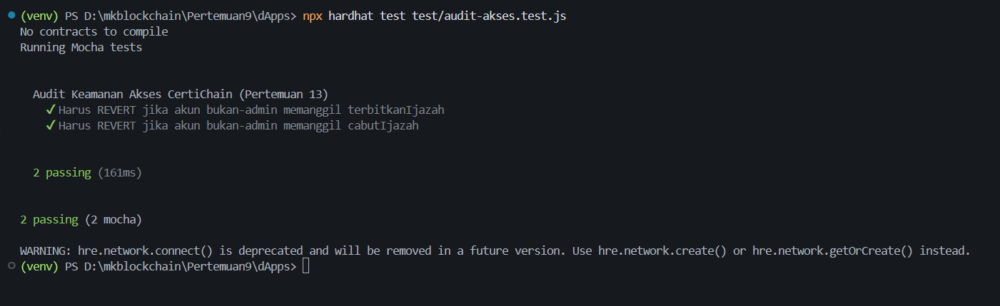
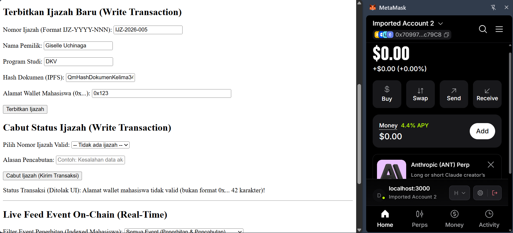

# Laporan Praktikum Pertemuan 13: Audit Keamanan Dasar dApp (`CertiChain`).

**Mata Kuliah:** Teknologi & Rekayasa Blockchain  
**Proyek dApp:** CertiChain (Sistem Penerbitan & Verifikasi Ijazah Digital)  
**Alamat Kontrak Lokal:** `0x5FbDB2315678afecb367f032d93F642f64180aa3`  
**Jaringan Pengujian:** Hardhat Local (Chain ID `31337`)


## 1. Inventaris Fungsi Tulis (`Certichain.sol`)

Seluruh fungsi yang mengubah *state* pada smart contract `CertiChain` telah diaudit hak akses dan pengamannya sebagai berikut:

| Fungsi | Boleh Dipanggil Oleh | Pengaman (`Modifier` / Cek) | Pemanggilan Luar (`call`/`transfer`) | Hasil Uji Akses |
| :--- | :--- | :--- | :--- | :--- |
| `terbitkanIjazah` | `adminKampus` (Deployer) | `onlyAdmin` + validasi nomor belum terdaftar | Tidak ada (Aman dari Reentrancy) | `revert` untuk bukan-admin ✓ |
| `cabutIjazah` | `adminKampus` (Deployer) | `onlyAdmin` + validasi ijazah ada & masih valid | Tidak ada (Aman dari Reentrancy) | `revert` untuk bukan-admin ✓ |


## 2. Pemeriksaan Reentrancy & Pola Checks-Effects-Interactions (CEI)

* **Analisis:** Kedua fungsi tulis (`terbitkanIjazah` dan `cabutIjazah`) hanya melakukan pembacaan dan pembaruan *state* internal (`mapping` `daftarIjazah` dan `ijazahMahasiswa`) serta memancarkan *event* (`emit`).
* **Kesimpulan:** Tidak terdapat transfer ETH maupun pemanggilan ke kontrak eksternal, sehingga smart contract bebas dari celah *reentrancy* dan tidak memerlukan tambahan `ReentrancyGuard`.


## 3. Audit UI & Kebersihan Repository

1. **Sinkronisasi Alamat Kontrak:** Alamat kontrak pada `app.js` (`0x5FbDB2315678afecb367f032d93F642f64180aa3`) sudah sesuai dengan hasil *deploy* terbaru pada node Hardhat lokal.
2. **Kebersihan Repository dari Kunci Rahasia:** Pemeriksaan pada file sumber (`index.html`, `app.js`, `Certichain.sol`) tidak menemukan *private key*, *seed phrase*, maupun *mnemonic* yang tertanam di dalam kode.
3. **Perilaku Pop-Up MetaMask:** Pada pengujian transaksi valid, pop-up MetaMask menampilkan alamat tujuan kontrak serta estimasi *gas* dengan benar sebelum pengguna melakukan konfirmasi.


## 4. Bukti Pengujian Akses (Otomatis & Manual)

### A. Pengujian Otomatis via Hardhat (`npx hardhat test`)
Pengujian otomatis pada `test/audit-akses.test.js` membuktikan bahwa pemanggilan fungsi `terbitkanIjazah` dan `cabutIjazah` oleh akun selain `adminKampus` ditolak (*revert*) dengan pesan `"Error: Hanya Admin Kampus yang memiliki akses!"`.



### B. Pengujian Manual via Frontend & MetaMask (Akun Bukan-Admin)
Pengujian manual dilakukan dengan mengganti akun MetaMask ke akun bukan-admin (`0x70997970C51812dc3A010C7d01b50e0d17dc79C8`) dan mencoba mengirimkan transaksi penerbitan ijazah `IJZ-2026-005`. Kontrak berhasil menolak transaksi tersebut (*revert*).


## 5. Daftar Temuan Audit & Perbaikan

### Temuan 1: Kurangnya Validasi Input & Dropdown Statis pada Frontend (`index.html` & `app.js`)
* **Tingkat:** Sedang
* **Bukti:** Pada versi awal frontend, form penerbitan ijazah belum memvalidasi format nomor ijazah maupun validitas alamat wallet penerima (`0x...`), dropdown pencabutan ijazah di-hardcode hanya sampai `IJZ-2026-003`, serta alasan pencabutan tidak memiliki batas panjang minimal.
* **Rekomendasi:** Tambahkan auto-fill alamat wallet saat koneksi dompet, isi dropdown pencabutan secara dinamis dari data *on-chain*, tambahkan validasi regex nomor ijazah (`/^IJZ-\d{4}-\d{3}$/`), validasi alamat Ethereum menggunakan `ethers.isAddress()`, serta validasi panjang minimal alasan pencabutan.

#### Perbaikan Kode Lengkap `app.js` (Sebelum — Sesudah)

**(`app.js`) Sebelum diUbah:**
```javascript
// 1. Elemen tampilan belum menyertakan referensi dropdown pilihIjazah
const elFeed = document.getElementById("elFeed");
const btnKirim = document.getElementById("btnKirim");

// 2. connectWallet belum mengisi otomatis input alamat mahasiswa
async function connectWallet() {
  const accounts = await window.ethereum.request({ method: "eth_requestAccounts" });
  const akunAktif = accounts[0];
  elAddress.innerText = akunAktif;
  // ...
}

// 3. muatDashboard belum memperbarui dropdown pencabutan secara dinamis
elDaftar.innerHTML = hasil.map((cert, index) => {
  const nomorIjazah = daftarNomor[index];
  const statusTeks = cert.isValid ? "Valid" : `Dicabut (${cert.alasanPencabutan})`;
  const tgl = new Date(Number(cert.tanggalTerbit) * 1000).toLocaleString("id-ID");

  return `<div class="kartu">...</div>`;
}).join("");

// 4. kirimTerbitkanIjazah tanpa validasi format nomor & alamat Ethereum
async function kirimTerbitkanIjazah() {
  const nomor = document.getElementById("inputNomorBaru").value.trim();
  const nama = document.getElementById("inputNamaBaru").value.trim();
  const prodi = document.getElementById("inputProdiBaru").value.trim();
  const hashDok = document.getElementById("inputHashBaru").value.trim();

  if (!nomor || !nama || !prodi || !hashDok) {
    elTx.innerText = "Status Transaksi: Lengkapi semua field penerbitan ijazah!";
    return;
  }

  const akunAktif = elAddress.innerText;
  const tx = await kontrakTulis.terbitkanIjazah(nomor, nama, prodi, hashDok, akunAktif);
  // ...
}

// 5. kirimCabutIjazah tanpa validasi panjang minimal alasan
async function kirimCabutIjazah() {
  const nomorIjazah = document.getElementById("pilihIjazah").value;
  const alasan = document.getElementById("inputAlasan").value.trim();

  if (!nomorIjazah || !alasan) {
    elTx.innerText = "Status Transaksi: Pilih nomor ijazah dan isi alasan pencabutan dulu!";
    return;
  }
  // ...
}
```

**(`app.js`) Sesudah diUbah:**
```javascript
// 1. Menambahkan referensi elemen dropdown pilihIjazah
const elFeed = document.getElementById("elFeed");
const pilihIjazah = document.getElementById("pilihIjazah");
const btnKirim = document.getElementById("btnKirim");

// 2. connectWallet otomatis mengisi alamat aktif ke form penerbitan
async function connectWallet() {
  const accounts = await window.ethereum.request({ method: "eth_requestAccounts" });
  const akunAktif = accounts[0];
  elAddress.innerText = akunAktif;
  document.getElementById("inputMhsBaru").value = akunAktif;
  // ...
}

// 3. muatDashboard mengisi opsi dropdown pencabutan secara dinamis dari data on-chain
pilihIjazah.innerHTML = `<option value="">-- Pilih Ijazah --</option>`;

elDaftar.innerHTML = hasil.map((cert, index) => {
  const nomorIjazah = daftarNomor[index];
  const statusTeks = cert.isValid ? "Valid" : `Dicabut (${cert.alasanPencabutan})`;
  const tgl = new Date(Number(cert.tanggalTerbit) * 1000).toLocaleString("id-ID");

  if (cert.isValid) {
    pilihIjazah.insertAdjacentHTML(
      "beforeend",
      `<option value="${nomorIjazah}">${nomorIjazah} (${cert.namaPemilik})</option>`
    );
  }

  return `<div class="kartu">...</div>`;
}).join("");

// 4. kirimTerbitkanIjazah dilengkapi validasi input kosong, regex nomor, dan ethers.isAddress
async function kirimTerbitkanIjazah() {
  const nomor = document.getElementById("inputNomorBaru").value.trim();
  const nama = document.getElementById("inputNamaBaru").value.trim();
  const prodi = document.getElementById("inputProdiBaru").value.trim();
  const hashDok = document.getElementById("inputHashBaru").value.trim();
  const alamatMhs = document.getElementById("inputMhsBaru").value.trim();

  if (!nomor || !nama || !prodi || !hashDok || !alamatMhs) {
    elTx.innerText = "Status Transaksi (Ditolak UI): Semua field penerbitan wajib diisi!";
    return;
  }

  if (!/^IJZ-\d{4}-\d{3}$/.test(nomor)) {
    elTx.innerText = "Status Transaksi (Ditolak UI): Format nomor ijazah harus IJZ-YYYY-NNN (contoh: IJZ-2026-005)!";
    return;
  }

  if (!ethers.isAddress(alamatMhs)) {
    elTx.innerText = "Status Transaksi (Ditolak UI): Alamat wallet mahasiswa tidak valid (bukan format 0x... 42 karakter)!";
    return;
  }

  const tx = await kontrakTulis.terbitkanIjazah(nomor, nama, prodi, hashDok, alamatMhs);
  // ...
}

// 5. kirimCabutIjazah dilengkapi validasi panjang minimal alasan pencabutan
async function kirimCabutIjazah() {
  const nomorIjazah = pilihIjazah.value;
  const alasan = document.getElementById("inputAlasan").value.trim();

  if (!nomorIjazah || !alasan) {
    elTx.innerText = "Status Transaksi (Ditolak UI): Pilih nomor ijazah dan isi alasan pencabutan dulu!";
    return;
  }

  if (alasan.length < 5) {
    elTx.innerText = "Status Transaksi (Ditolak UI): Alasan pencabutan minimal 5 karakter!";
    return;
  }
  // ...
}
```

* **Bukti Hasil Uji Ulang Setelah Perbaikan:** Saat dimasukkan alamat tidak valid (`0x123`), UI langsung menolak input sebelum membuka pop-up MetaMask.



* **Status:** **Diperbaiki**

### Temuan 2: Belum Tersedia Fungsi Pemindahan Hak Admin (`transferAdmin`) pada Kontrak
* **Tingkat:** Rendah
* **Bukti:** Variabel `adminKampus` hanya ditetapkan satu kali di dalam `constructor()` tanpa fungsi untuk mengalihkan kepemilikan admin jika terjadi pergantian petugas atau kehilangan akses akun.
* **Rekomendasi:** Tambahkan fungsi `transferAdmin(address _adminBaru)` yang diproteksi modifier `onlyAdmin` dan validasi `address(0)`.
* **Status:** **Ditunda** (Alasan: Di luar ruang lingkup modul praktikum dan untuk menjaga kontrak yang sudah ter-deploy di jaringan lokal tetap stabil tanpa perubahan *state*).

### Temuan 3: Fungsi Cek Detail Ijazah (`muatStatus`) Masih Di-hardcode pada Nomor Tunggal
- **Tingkat:** Rendah
- **Bukti:** Fungsi `muatStatus()` pada `app.js` hanya memanggil `kontrak.verifikasiIjazah("IJZ-2026-001")` secara statis tanpa menyediakan kolom input pencarian nomor ijazah lain.
- **Rekomendasi:** Tambahkan elemen `<input>` pencarian nomor ijazah di `index.html` dan baca nilainya secara dinamis di dalam `muatStatus()`.
- **Status:** **Ditunda** (Alasan: Pengguna tetap dapat melihat daftar lengkap seluruh ijazah miliknya melalui fitur *Refresh Dashboard* (`muatDashboard()`), sehingga fungsi *read* individual tetap dipertahankan sebagai pengujian *smoke test* awal).

### Temuan 4: Tombol Transaksi Admin Tetap Aktif untuk Akun Bukan-Admin (`connectWallet`)
- **Tingkat:** Rendah
- **Bukti:** Pada `connectWallet()` di `app.js`, tombol `btnTerbitkan` dan `btnKirim` langsung diaktifkan (`disabled = false`) tanpa membandingkan alamat dompet aktif dengan `adminKampus`. Meski smart contract tetap aman karena menolak transaksi (*revert*), pengguna non-admin tetap berpotensi membuang *gas fee* jika transaksi terkirim.
- **Rekomendasi:** Lakukan pengecekan `akunAktif.toLowerCase() === admin.toLowerCase()` saat koneksi dompet untuk menonaktifkan tombol khusus admin bagi akun mahasiswa/publik.
- **Status:** **Ditunda** (Alasan: Sengaja dibiarkan aktif pada tahap praktikum ini untuk mempermudah pengujian *revert* akses secara manual melalui frontend dan MetaMask).

### Temuan 5: Hardcode Alamat Wallet pada Filter Live Event (`terapkanFilterFeed`)
- **Tingkat:** Rendah
- **Bukti:** Fungsi `terapkanFilterFeed()` masih menanamkan alamat akun Hardhat secara statis (`0xf39F...` dan `0x7099...`) untuk memfilter parameter `indexed` mahasiswa.
- **Rekomendasi:** Ganti pilihan statis menjadi input alamat dinamis atau opsi otomatis berdasarkan alamat wallet yang sedang terhubung.
- **Status:** **Ditunda** (Alasan: Fitur warisan dari modul Pertemuan 12 yang difokuskan untuk pengujian cepat dua akun standar Hardhat lokal).