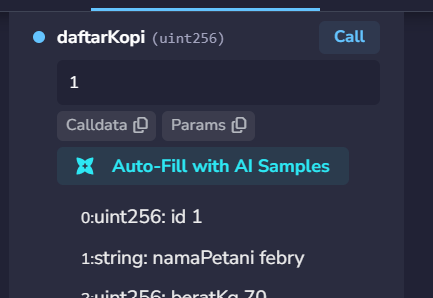

# Praktikum 6: Membuat Smart Contract dengan Solidity di Remix #

## Tujuan Pembelajaran
Setelah menyelesaikan praktikum ini, mahasiswa diharapkan mampu:
1. Memahami konsep dasar dari smart contract pada Blockchain.
2. Menggunakan platform Remix untuk menulis, mengompilasi, dan men-deploy smart contract berbasis Solidity.
3. Mengimplementasikan fungsionalitas dasar smart contract yang melibatkan state variable dan fungsi.
4. Melakukan interaksi dengan smart contract yang sudah ter-deploy melalui Remix.

## Proses Praktikum
1. Buka [Remix IDE](https://remix.ethereum.org/) login via Gmail, bukti:

2. Buat file baru di files dengan nama file (SupplyChainKopi.sol)
Isi coding sesuai dengan modul.

3. Compile Smart Contract

4. Deploy & Testing Smart Contract
### A. Deploy Smart Contract + Menambahkan Data Panen Baru (`daftarPanenBaru`)

### B. Memanggil Data Panen (`daftarKopi`)

