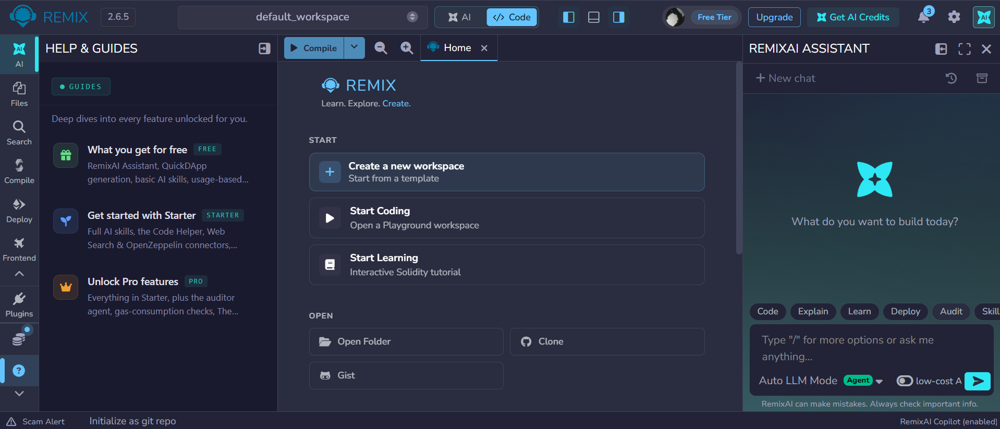
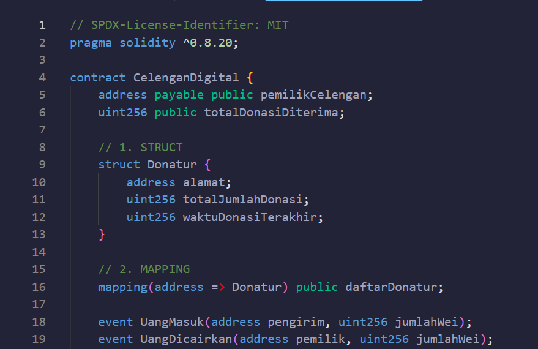
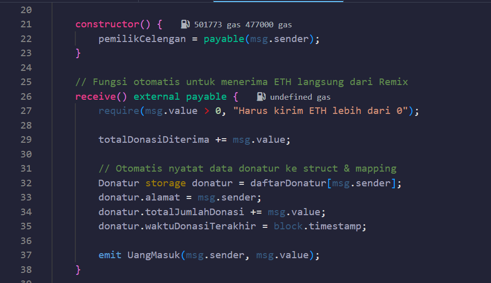
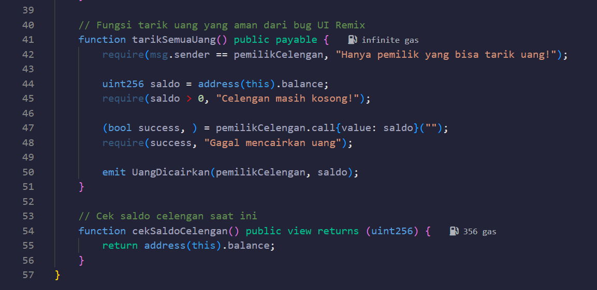
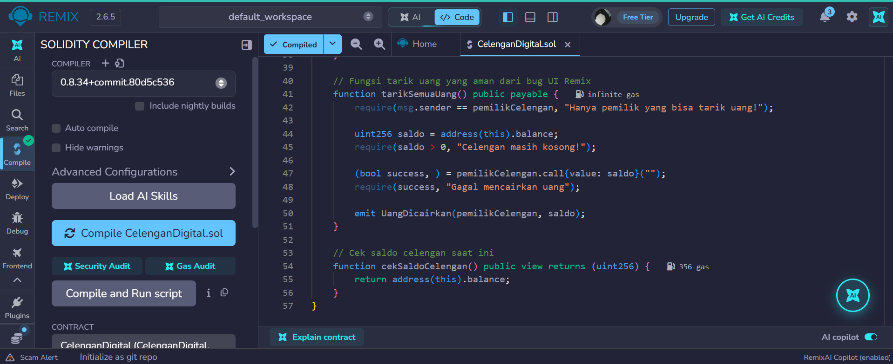
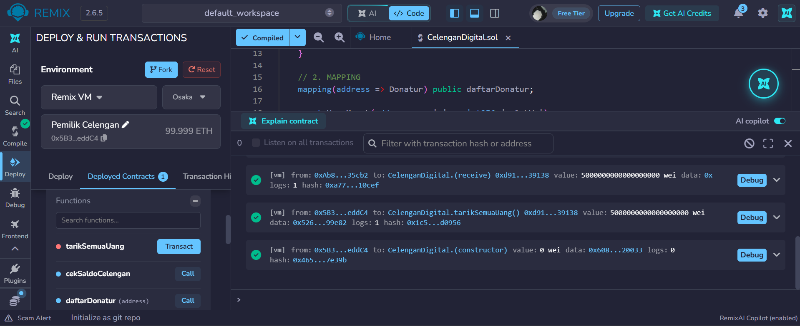
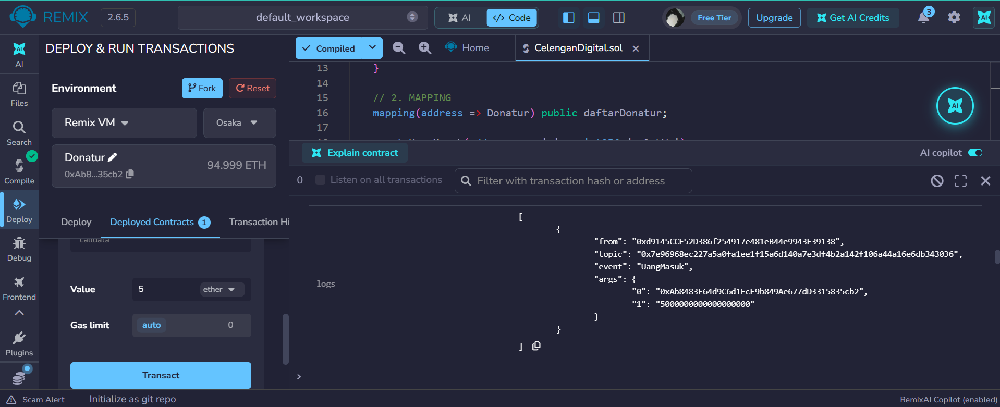
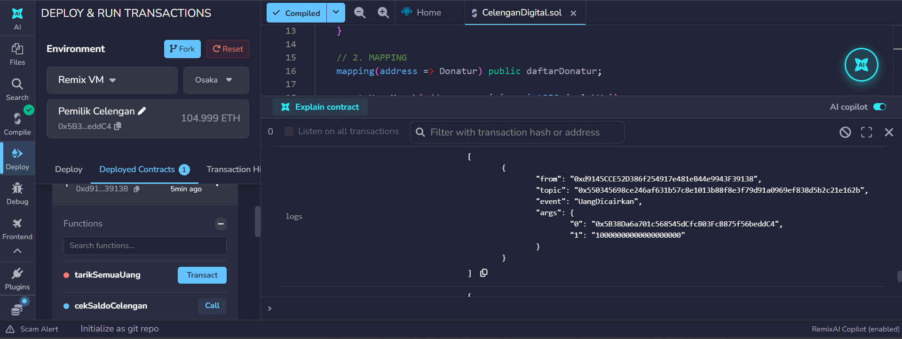
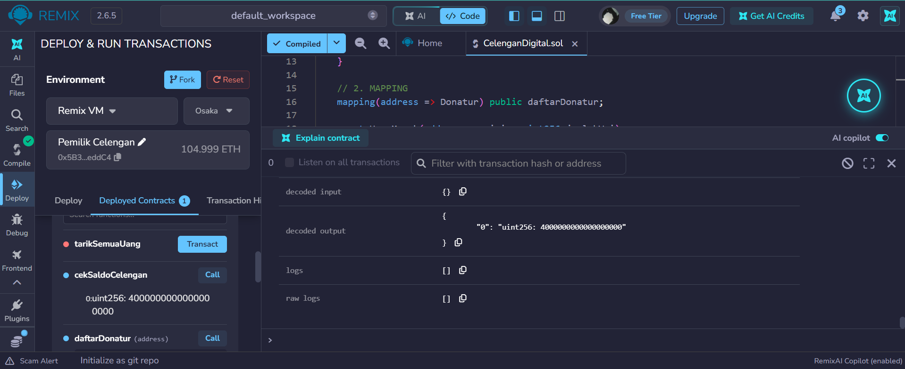
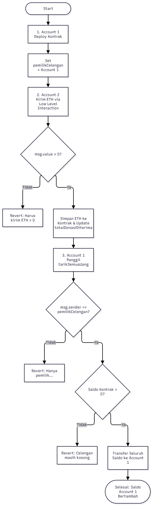

# Praktikum 6 Tugas Kelompok: Membuat Smart Contract dengan Solidity di Remix #

### KELOMPOK 7 ###
- Akhmad Febri Dimyati
- Moh. Ni'am Billi Yachsyi
- Agung Dwi Jaya
- Jouvan Labib

## Tujuan Pembelajaran
Setelah menyelesaikan praktikum ini, mahasiswa diharapkan mampu:
1. Memahami konsep dasar dari smart contract pada Blockchain.
2. Menggunakan platform Remix untuk menulis, mengompilasi, dan men-deploy smart contract berbasis Solidity.
3. Mengimplementasikan fungsionalitas dasar smart contract yang melibatkan state variable dan fungsi.
4. Melakukan interaksi dengan smart contract yang sudah ter-deploy melalui Remix.

## Proses Praktikum
1. Buka [Remix IDE](https://remix.ethereum.org/) login via Gmail, bukti:

2. Buat file baru di files dengan nama file (`CelenganDigital.sol`)

3. Compile Smart Contract

4. Deploy & Testing Smart Contract
### A. Deploy Smart Contract oleh Pemilik & Mengirim Donasi
* **Deploy Kontrak oleh Pemilik (`pemilikCelengan`):**

* **Pengiriman Donasi oleh Donatur (`receive`):**

### B. Menarik Uang & Memanggil Saldo
* **Menarik Uang (`tarikSemuaUang`):**

* **Memanggil Saldo (`cekSaldoCelengan`):**

## Evaluasi & Tugas Kelompok
1. **Desain Arsitektur (Flowchart)**

* **Struktur Data (`Struct`)**: Memuat data `Donatur` (alamat dompet, total donasi, dan waktu donasi).
* **Pemetaan (`Mapping`)**: `mapping(address => Donatur) public daftarDonatur` untuk mencatat nominal riwayat donasi.
* **Alur Fungsi**:
  * `receive()`: Menerima transfer ETH langsung ke kontrak.
  * `tarikSemuaUang()`: Mencairkan seluruh saldo ke akun pemilik.
  * `cekSaldoCelengan()`: Menampilkan sisa saldo kontrak.

2. **Drafting Smart Contract (Versi 1)**
Smart contract `CelenganDigital.sol` telah berhasil diimplementasikan dengan `struct` dan `mapping` serta terbukti dapat di-compile tanpa error (Centang hijau Bagian 3 diatas).

## File Celengan Digital
[CelenganDigital.sol](../../../../Downloads/CelenganDigital.sol)