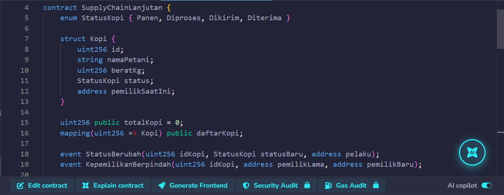
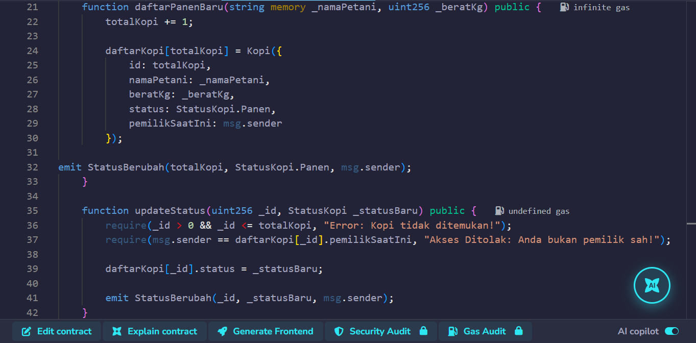
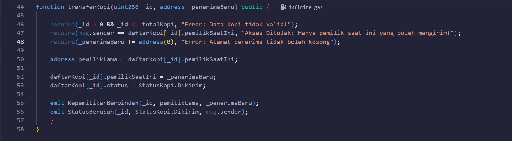
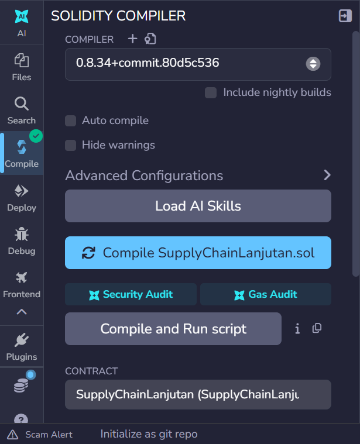
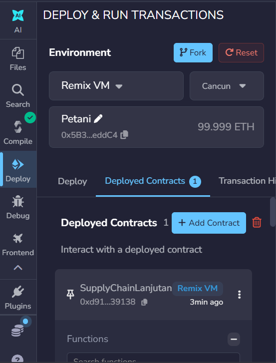
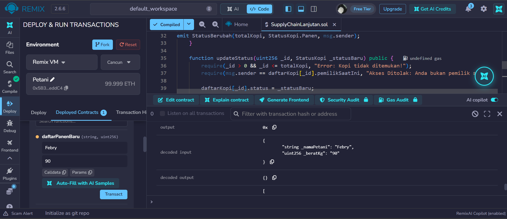
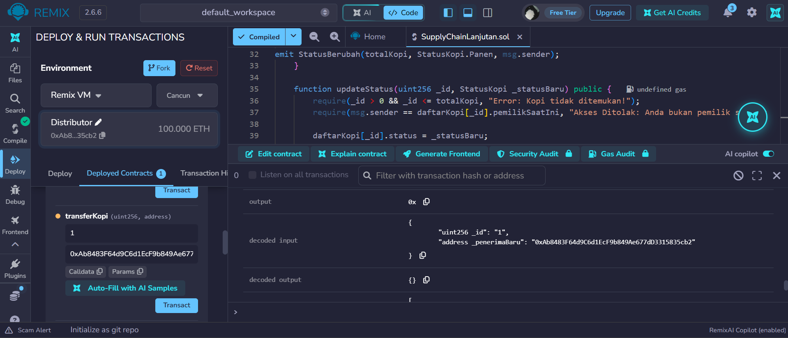

# Praktikum 7: Logika Smart Contract Lanjutan #

## A. Tujuan Praktikum
1. Mahasiswa mampu memahami dan menerapkan Event pada Solidity untuk mencatat riwayat transaksi secara efisien.
2. Mahasiswa mampu menggunakan Require untuk membangun sistem kontrol akses (Access Control) yang aman.
3. Mahasiswa mampu mengimplementasikan logika pemindahan hak milik (Transfer Ownership) atas suatu aset digital.
4. Mahasiswa mulai merancang dan menulis kode Smart Contract (Versi 1) sesuai dengan studi kasus proyek kelompok masing-masing.

## B. Persiapan Lingkungan Kerja (Remix IDE)
1. Buka kembali browser dan akses https://remix.ethereum.org/
2. Buka file SupplyChainKopi.sol yang telah dikerjakan pada minggu sebelumnya, atau buat file baru bernama SupplyChainLanjutan.sol.

## C. Langkah Kerja Praktikum
**Tahap 1: Mendefinisikan Events (Notifikasi Sistem)**

**Tahap 2: Memicu (Emit) Event pada Fungsi**

**Tahap 3: Membangun Logika Transfer Kepemilikan**

**Tahap 4: Compile & Pengujian Logs di Remix**
1. Compile kode Anda (Ctrl+S atau tekan tombol Compile).

2. Pindah ke panel Deploy & Run Transactions, pastikan menggunakan Remix VM (Cancun), lalu klik Deploy.

3. Di dalam Deployed Contracts:
- Daftarkan kopi baru menggunakan akun pertama.
- Salin (Copy) alamat wallet akun kedua dari menu dropdown Account di atas.
- Kembali ke akun pertama, dan jalankan fungsi transferKopi dengan memasukkan _id: 1 dan menempelkan (Paste) alamat akun kedua tadi pada kolom _penerimaBaru.

4. CEK EVENT: Buka Terminal di bagian bawah layar. Klik tanda panah bawah pada transaksi hijau yang baru saja berhasil. Gulir ke bawah hingga Anda menemukan kolom logs. Di sana Anda akan melihat rekaman Event KepemilikanBerpindah!
