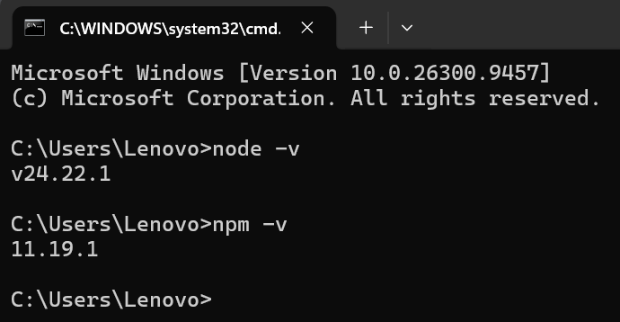
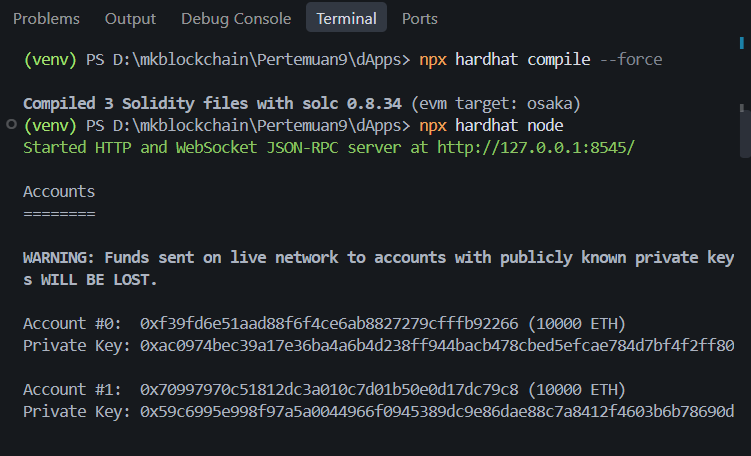
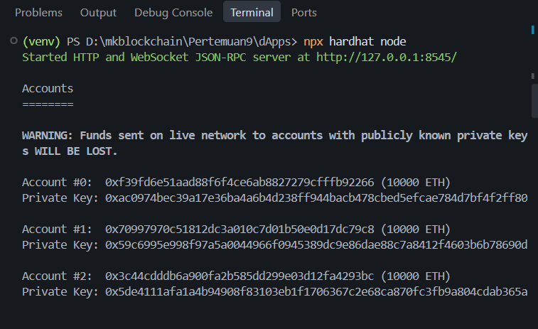
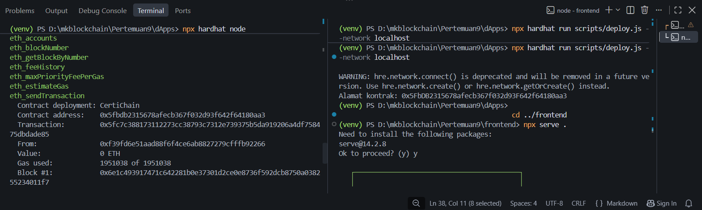
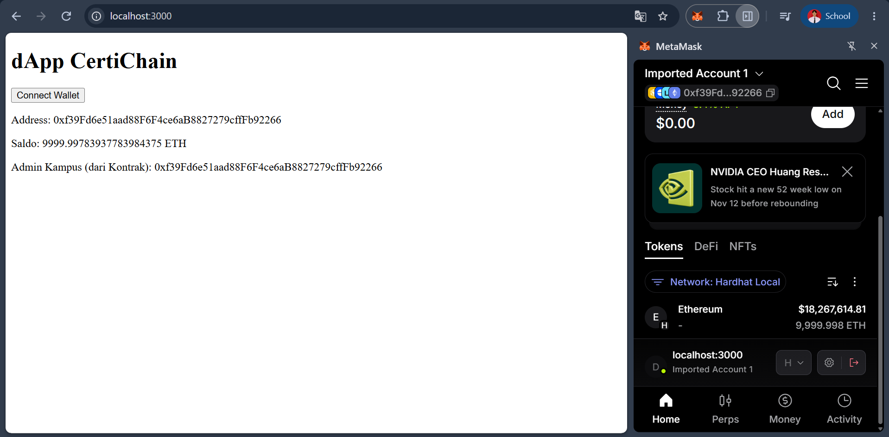

# INTEGRASI FRONT END & WEB3

## Langkah Praktikum

1. Cek instalasi Node.js dan NPM (`node -v`, `npm -v`)
2. Jika belum tersedia, instal melalui https://nodejs.org/en/download
3. Bukti instalasi Node.js dan NPM

4. Buat folder baru dengan nama `dApps`
5. Buka terminal pada folder tersebut
6. Inisialisasi NPM (`npm init -y`)
7. Instal framework Hardhat
8. Menjalankan inisialisasi Hardhat (`npx hardhat init`)
9. Unduh dan tempatkan file smart contract (`CertiChain.sol`) yang sudah dibuat di Remix ke dalam folder `contracts`
10. Compile smart contract dengan perintah `npx hardhat compile`

11. Menjalankan Node untuk mendapatkan aktor dan addressnya (npx hardhat node)

12. Membuat script `deploy.js` di dalam folder `scripts`
13. Deploy smart contract ke jaringan lokal (`npx hardhat run scripts/deploy.js --network localhost`) hingga mendapatkan alamat kontrak (`0x5FbDB2315678afecb367f032d93F642f64180aa3`)

14. Membuat folder `frontend` serta file `index.html` dan `app.js` untuk menghubungkan antarmuka web dengan MetaMask dan smart contract menggunakan `ethers.js`
15. Instal ekstensi MetaMask pada browser
16. Login atau buat akun wallet baru di MetaMask
17. Membuat *custom network* baru dengan nama **Hardhat Local** (RPC URL: `http://127.0.0.1:8545`, Chain ID: `31337`, Currency: `ETH`)
18. Mengimpor akun lokal dari Hardhat Node ke MetaMask menggunakan *private key*
19. Menjalankan server lokal pada folder `frontend` dengan perintah `npx serve .` dan membuka `http://localhost:3000` di browser
20. Melakukan koneksi wallet (*Connect Wallet*) melalui MetaMask dan memverifikasi pembacaan data akun (*Address*, *Saldo ETH*) serta data dari smart contract (`adminKampus`)

## Kesimpulan

Integrasi antara *frontend* berbasis HTML/JavaScript dengan *smart contract* `CertiChain` pada jaringan lokal Hardhat berhasil dilakukan menggunakan library `ethers.js` dan ekstensi dompet MetaMask. Melalui tombol *Connect Wallet*, aplikasi web mampu mengautentikasi akun pengguna, membaca saldo ETH lokal, serta mengambil data *state* (`adminKampus`) secara langsung dari *smart contract* yang telah di-*deploy*.
